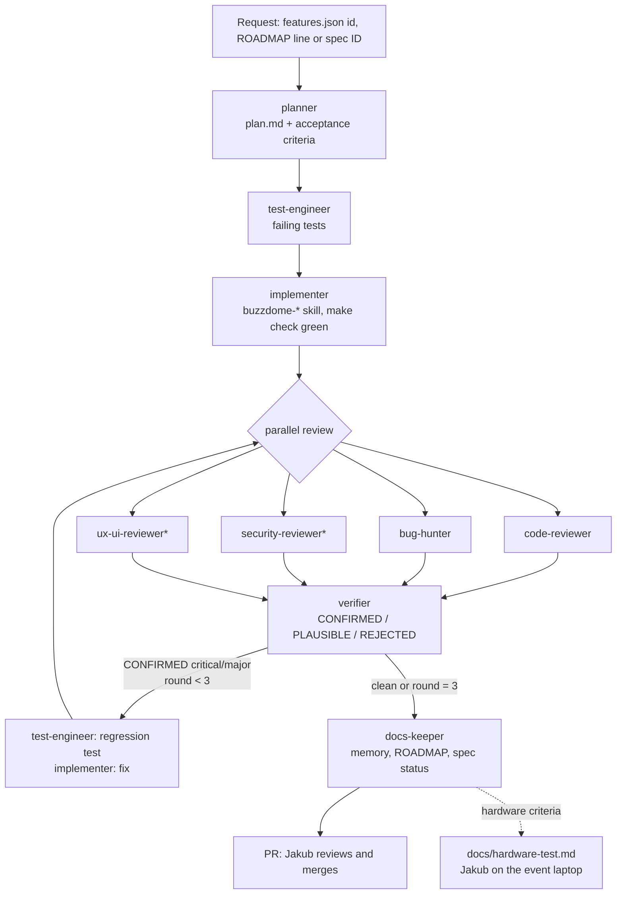

# Multi-agent workflow

How the AI agents working on Buzzdome divide work, hand it off and check each
other. The design follows published practice from Anthropic, OpenAI and
GitHub; the sources are in [`agent-research.md`](agent-research.md). It came
from Jakub's `dev_template` and is tailored here to a live-show desktop app
(ADR-0001).

## Principles

1. **Separation of duties.** Planning, testing, implementing, reviewing and
   verifying are done by different agents with fresh contexts. A reviewer
   that did not write the code is not biased toward it (Claude Code best
   practices, https://code.claude.com/docs/en/best-practices).
2. **Test-first, by a different agent.** `test-engineer` writes failing tests
   from the acceptance criteria; `implementer` makes them pass and may not
   edit tests.
3. **Find, verify, rank.** Specialist reviewers look for problems in
   parallel; an independent `verifier` rejects false positives before anyone
   fixes anything (the structure of Claude Code Review,
   https://code.claude.com/docs/en/code-review).
4. **Fix loop with a budget.** Fix, re-review, re-verify: at most 3 rounds,
   then Jakub decides (evaluator-optimizer pattern, Anthropic, "Building
   effective agents",
   https://www.anthropic.com/engineering/building-effective-agents).
5. **Evidence, not claims.** Every report includes the commands run and
   their output.
6. **Deterministic guardrails.** Rules that must never break are enforced by
   hooks, tests and CI, not only by prompts (hooks are deterministic,
   instructions are advisory, https://code.claude.com/docs/en/hooks). In
   Buzzdome most invariants already have a test: the window capabilities, the
   journal contract, stale bindings, `controls` against `apply`, the soak and
   crash drills.
7. **One feature per session, state on disk.** Progress lives in `memory/`
   and git so a fresh session can resume
   (https://www.anthropic.com/engineering/effective-harnesses-for-long-running-agents).
8. **The hardware is Jakub's.** No agent can press a real buzzer. Hardware
   criteria end as a section in `docs/hardware-test.md`; Jakub runs it and
   writes the result back (`buzzdome-hardware` skill).

## Roles

| Agent | Writes to | Model | Purpose | Follows |
| --- | --- | --- | --- | --- |
| `planner` | `.work/`, `docs/adr/` | opus | Plan, acceptance criteria, test plan, risks, ADR draft | spec, `replica/recon.md`, `docs/architecture.md` |
| `test-engineer` | test code only | sonnet | Failing tests first, regression tests for confirmed bugs | `.claude/rules/testing.md` |
| `implementer` | code | sonnet | Make tests pass, fix CONFIRMED findings, commit | the `buzzdome-*` skill of each layer |
| `code-reviewer` | `.work/` (findings) | sonnet | Correctness, invariants, test quality | `REVIEW.md` |
| `security-reviewer` | `.work/` (findings) | sonnet | Files and ZIPs, IPC, child processes, MCP roots, updates, CI | `REVIEW.md` |
| `ux-ui-reviewer` | `.work/` (findings) | sonnet | The windows in the browser preview: show flow, projector readability, layout, copy | `buzzdome-ui-change`, `buzzdome-layout` |
| `bug-hunter` | `.work/` (repros) | sonnet | Odd command orders, crashes mid-show, malformed files, press storms | `show-sim`, crash drills, fake receiver |
| `verifier` | `.work/` | opus | Confirm or reject every finding, dedupe, rank | the code |
| `docs-keeper` | `memory/`, `docs/`, `ROADMAP.md`, `replica/features.csv` | haiku | Progress log, decisions, lessons, feature status | `memory/README.md` |

Model choices are defaults: stronger models where judgment matters
(planning, verification), cheaper ones for routine work. Change `model:` per
agent in `.claude/agents/`.

## Pipeline (`/feature`)



`*` only when the diff touches files, processes, IPC, updates, dependencies
or CI (security), or `app/src` (UX).

CI runs the same checks again (`.github/workflows/build.yml`), and an
optional independent AI review can run on the PR
(`.github/workflows/claude-review.yml`, off until enabled). Agents never
approve, merge, bump the version or push a `v*` tag: a tag publishes a
release to every installed app (`docs/releasing.md`).

## Which skill for which task

| Task | Skill |
| --- | --- |
| A feature end to end | `/feature` |
| Review a branch or PR | `/review` |
| Break an area on purpose | `/bug-hunt` |
| UX of the windows | `/ux-audit` |
| A hard-to-reverse decision | `/adr` |
| End a session | `/handoff` |
| Checks before a commit or PR | `buzzdome-verify` (or `make check`) |
| A Tauri command or backend event | `buzzdome-backend-command` |
| Game rules, scoring, quiz format | `buzzdome-game-rules` |
| Director, slides, editor, texts | `buzzdome-ui-change` |
| Layout of every window | `buzzdome-layout` (`make layout`) |
| Buzzers, receiver, remote, stage lights | `buzzdome-hardware` |

A one-line fix does not need the pipeline: implement it, run the checks
that apply and `/review` once.

## Artifacts in `.work/<task-slug>/`

| File | Producer | Consumer |
| --- | --- | --- |
| `plan.md` | planner | everyone |
| `findings-code.md`, `findings-security.md`, `findings-ux.md`, `findings-bugs.md` | reviewers | verifier |
| `repro/` | bug-hunter | verifier, test-engineer |
| `screens/` | ux-ui-reviewer, `make layout` | verifier, Jakub |
| `verified-findings.md` | verifier | implementer, test-engineer, Jakub |

`.work/` is gitignored scratch space. Anything worth keeping goes to
`memory/` or `docs/` through `docs-keeper`.

## Handoff report

Every subagent ends with this report; the orchestrator keeps only this, not
the whole transcript:

```markdown
### Handoff: <agent> - <task-slug>
- **Status:** done | blocked | needs-decision
- **Summary:** 1-3 sentences
- **Artifacts:** paths written
- **Evidence:** commands run + relevant output (trimmed)
- **Findings:** count by severity (reviewers) or n/a
- **Open questions / next step:**
```

## Finding format

```yaml
- id: CR-1                # CR | SEC | UX | BUG | VER
  severity: critical      # critical | major | minor | nit (see REVIEW.md)
  confidence: high        # high | medium | low
  location: crates/quiz-core/src/game.rs:42
  problem: One sentence.
  failure_scenario: concrete input -> wrong output / crash (exact command for BUG)
  suggested_fix: One or two sentences.
  verdict: CONFIRMED      # added by verifier: CONFIRMED | PLAUSIBLE | REJECTED
  verdict_reason: ...
```

## Cross-tool mapping

| Concept | Claude Code | OpenAI Codex | GitHub Copilot |
| --- | --- | --- | --- |
| Project instructions | `CLAUDE.md` (imports `AGENTS.md`) | `AGENTS.md` | `AGENTS.md`, `.github/copilot-instructions.md` |
| Subagents | `.claude/agents/*.md` (source) | `.codex/agents/*.toml` (generated) | `.github/agents/*.agent.md` (generated) |
| Skills | `.claude/skills/*/SKILL.md` (source) | `.agents/skills/` (generated) | - |
| Path rules | `.claude/rules/*.md` | - | - |
| Guardrails | `.claude/settings.json` hooks | sandbox / approval policy | repository rulesets |

Edit only the sources and run `python3 scripts/sync_agents.py`;
`.github/workflows/agents.yml` fails if generated files are stale. The
generated copies carry no `tools:` limits, so Codex and Copilot rely on their
own sandbox and approval settings.

## Tools

- **Browser for UX review:** the preview with a mocked backend
  (`make preview`, `/preview.html?window=<director|host>&scene=<name>`).
  `.mcp.json` registers Playwright MCP
  (https://github.com/microsoft/playwright-mcp); the layout check
  (`make layout`) is the one Playwright script kept in the repository.
- **The real app:** `make e2e` on Linux (WebDriver through `tauri-driver`);
  Windows E2E only on CI.
- **Hooks** (`.claude/hooks/`): `guard-bash.sh` blocks destructive commands,
  force pushes, release tags, force-adding ignored files and printing
  secrets; `protect-files.sh` blocks edits to secrets, lockfiles,
  `app/src/bindings`, generated agent copies and the reference manual
  copies. They need `jq` or `python3`.
- **Cost control:** multi-agent runs use many more tokens than one chat
  (Anthropic measured about 15x for its research system,
  https://www.anthropic.com/engineering/multi-agent-research-system), and
  Actions minutes are limited. Use `/feature` for real features, not for
  one-line fixes.
